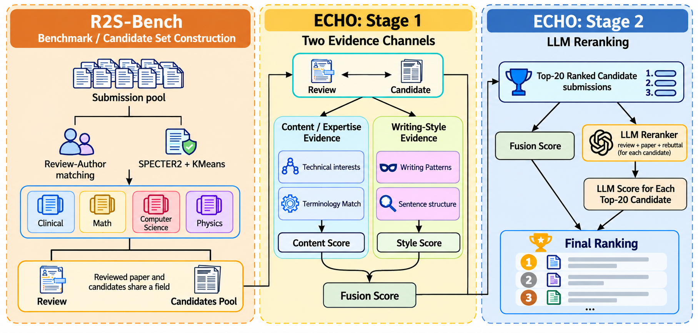

# R2S-Bench and ECHO: review-to-submission linkage

<p align="center"></p>

Code and benchmark for the paper *ECHO: Revealing Review-to-Submission Linkage in Anonymous Peer Review*
by Rong Wang and Mulong Luo (Florida State University). arXiv link to follow.

* **R2S-Bench** – 298 instances. Each pairs one sanitized anonymous review with a candidate set of submissions
  from the same research area (median 414) and one ground-truth submission written by the reviewer.
  Every candidate is represented by its paper (title + abstract) and its rebuttal.
* **ECHO** – Stage 1 fuses 46 content and writing-style similarity signals with a conditional logit;
  Stage 2 reranks the fusion top-20 with an LLM (0–100 pairwise score) and combines both scores.

Reproducing the paper means recomputing the Stage-1 signals (one GPU, a few hours) and the Stage-2 LLM
judgements (API access, about \$3 for GPT-6 Luna on the full benchmark).

## The paper in brief

**Threat.** At many venues, researchers who submit papers also review in the same cycle, so an anonymous review
coexists with public artifacts written by the same person: their own submission and, when available, its rebuttal.
We ask whether a review can be linked to the reviewer's own submission using only these routinely released
artifacts, with no reviewer profiles, no previously labeled reviews, and no platform metadata. Each candidate is a
single submission, never an aggregated author profile, so a successful link shrinks the reviewer's anonymity set to
that paper's authors.

**Benchmark.** R2S-Bench is built from the F1000 open-research platform (11 journals), where reviews are publicly
signed and articles carry author responses. Signatures are used only to establish ground truth. From 12,466
articles, 37,673 reviews and 13,117 rebuttals we identify 2,727 reviewer-authors (ORCID or conservative
name + affiliation matching), group articles into eight research areas (KMeans on SPECTER2), and build for each
review a candidate set of same-area submissions that were public at review time. The final benchmark has 298
instances from 256 reviewer-authors with a median of 414 candidates.

**Method.** ECHO standardizes 46 similarity signals within each candidate set and fuses them with a conditional
logit: a content channel (chunked dense similarity from six encoder configurations, BM25, character n-grams,
between the review and both the candidate paper and its rebuttal) and a writing-style channel (handcrafted
stylometric features on deterministically content-masked text, plus the STAR authorship encoder, between the
review and the rebuttal). An LLM then reranks the fusion top-20 from a 0–100 pairwise score, combined with the
fusion score (α chosen on reviewer-disjoint folds).

### Main results (298 instances, median 414 candidates)

| Method | Top-1 | Top-5 | Top-10 | Top-20 | Time | Cost |
|---|---|---|---|---|---|---|
| Random | 0.5% | 2.6% | 5.3% | 10.5% | – | – |
| Open-source LLM, full pool (Qwen3-32B) | 7.0% | 14.4% | 21.1% | 31.5% | 14.5 h | – |
| Closed-source LLM, full pool (GPT-6 Luna) | 18.5% | 35.6% | 44.6% | 54.7% | 4.5 h | $40.9 |
| **ECHO** (GPT-6 Luna) | 34.6% | 54.0% | 63.4% | 67.4% | 2.5 h | $2.74 |
| ECHO (Claude Opus 5.5)† | 44.3% | 60.4% | 64.8% | 67.4% | 3.7 h | $81 |
| ECHO (GPT-6 Astra) | 56.4% | 65.4% | 66.4% | 67.4% | 2.4 h | $143 |

†Claude Opus 5.5 declined 9.2% of the pairwise judgements on safety grounds; declined judgements are scored as
neutral. On a random 20-instance subset, GPT-6 Astra scoring every candidate directly reaches a Top-10 of 95.0%
versus 80.0% for ECHO with Astra, but at $228 for the subset (about $3,400 for the whole benchmark) against $9.6.

Scoring every candidate with the same LLM is both worse and far more expensive than first exploiting content and
style evidence and reranking a short list. Top-20 is bounded by the Stage-1 recall of 67.4%.

### Ablations (full pipeline, GPT-6 Luna reranker)

| Variant | Top-1 | Top-5 | Top-10 |
|---|---|---|---|
| Fusion only (no reranking) | 26.5% | 47.0% | 58.7% |
| LLM only on the fusion top-20 | 24.8% | 51.7% | 62.4% |
| Paper only | 30.5% | 49.0% | 54.7% |
| Rebuttal only | 30.9% | 52.7% | 59.7% |
| Content evidence only | 28.9% | 52.0% | 59.4% |
| Writing-style evidence only | 24.8% | 42.3% | 48.3% |
| Full ECHO | 34.6% | 54.0% | 63.4% |

### Effect of AI rewriting of the review

Reviews rewritten by GPT-6 Luna (light: grammar and clarity; heavy: neutral academic English), attacker unchanged.

| Review | semantic sim. | style sim. | Top-1 | Top-5 | Top-10 | content bits | style bits |
|---|---|---|---|---|---|---|---|
| Original | – | – | 34.6% | 54.0% | 63.4% | 1.12 | 0.43 |
| Light rewrite | 0.998 | 0.92 | 22.1% | 42.3% | 56.7% | 1.12 | 0.37 |
| Heavy rewrite | 0.993 | 0.59 | 20.5% | 40.3% | 49.7% | 1.09 | 0.17 |

Rewriting suppresses the style channel (0.43 → 0.17 bits) but leaves the content channel almost untouched
(1.12 → 1.09 bits): the attack weakens but the reviewer's submission still lands in the top 10 for more than half
of the heavily rewritten reviews. Bits are the information gain over uniform guessing of a ranker using one channel
alone, log₂N + log₂P(true candidate), averaged over instances.

## Layout


```
benchmark/          the public benchmark (see benchmark/README.md for the schema)
echo/               method and evaluation code (modules listed below)
construction/       the pipeline that built the benchmark from PubMed Central XML (needs raw data, see below)
work/cache/         feature caches written by the scripts (created on first run)
outputs/            reports and LLM judgement caches written by the scripts (created on first run)
```

## Setup

Python 3.12; `pip install -r requirements.txt` and `python -m spacy download en_core_web_sm`. Scripts are run
from `echo/`.

## Reproducing the paper

```
cd echo
python benchmark.py                               # loads the benchmark: 298 instances, 256 reviewers, median 414 candidates

# Stage 1: the 46 similarity signals (downloads the encoders from Hugging Face; one GPU)
python signals.py features archive
python signals.py combined
python fusion.py combined-evaluate star           # Stage-1 ranking alone (the "Fusion only" row of Table 3)

# Stage 2 and Table 2, ECHO rows (judgements are cached under outputs/llm_rerank/ and never re-requested)
export OPENROUTER_API_KEY=...
python rerank.py run  --model openai/gpt-6-luna --mode score --reasoning-budget 2000 --max-tokens 2400 --k 20
python rerank.py eval --model openai/gpt-6-luna --mode score --reasoning-budget 2000 --max-tokens 2400 --k 20
# stronger rerankers through Amazon Bedrock
export AWS_REGION=us-east-1 AWS_BEARER_TOKEN_BEDROCK=...
LLM_BACKEND=bedrock python rerank.py run --model us.anthropic.claude-opus-5-5 --mode score --reasoning-effort low --max-tokens 2400 --k 20
LLM_BACKEND=bedrock python rerank.py run --model us.openai.gpt-6-astra --mode score --reasoning-effort low --max-tokens 2400 --k 20
python -m analysis.compare_rerankers              # head-to-head paired bootstraps between rerankers

# Table 2, full-candidate-set LLM baselines (--k 2000 scores every candidate; expensive)
LLM_BACKEND=bedrock python rerank.py run --model us.openai.gpt-6-luna --mode score --reasoning-effort low --max-tokens 2400 --k 2000
LLM_BACKEND=bedrock python rerank.py run --model us.openai.gpt-6-astra --mode score --reasoning-effort low --max-tokens 2400 --k 2000 --qids ../benchmark/splits/subset20_fullpool.json
# open-weight baseline through any OpenAI-compatible endpoint (we used vLLM, thinking disabled)
LLM_BASE_URL=http://localhost:8001/v1 LLM_API_KEY=... python rerank.py run --model Qwen/Qwen3-32B --mode score --max-tokens 16 --k 2000

# Table 3 (ablations with the full pipeline), Table 4 (AI rewriting, full pipeline) and the channel analysis
python -m analysis.ablation
python -m analysis.rewriting rewrite && python -m analysis.rewriting features && python -m analysis.rewriting evaluate
python -m analysis.rewriting rerank && python -m analysis.rewriting report
python -m analysis.decomposition && python -m analysis.channel_bits
```

Modules in `echo/`:

| module | contents |
|---|---|
| `config.py`, `benchmark.py` | paths; loader for the released benchmark |
| `encoders.py` | SPECTER2, the chunked dense encoders of the content channel, the authorship encoders (STAR, LUAR, StyleDistance) |
| `style.py` | handcrafted stylometric features and the deterministic content masking |
| `signals.py` | builds the 46 Stage-1 signals (dense, BM25, character n-gram, masked style, STAR) for paper and rebuttal |
| `fusion.py` | within-instance standardization, conditional-logit fusion, reviewer-grouped cross-validation, metrics, bootstraps |
| `rerank.py`, `rerank_listwise.py` | Stage-2 LLM reranking (pointwise 0–100 scores; OpenRouter, Bedrock or any OpenAI-compatible endpoint) and the listwise variant |
| `scores.py` | single-signal score tables used by the analyses |
| `analysis/` | ablations, AI rewriting, content/style information decomposition, reranker comparison, authorship-model comparison |

Each `run` is resumable: judgements are appended to a cache keyed by a hash of model name and prompt, and `eval`
reads only from the cache. Metrics: Top-k is the share of instances whose true submission is ranked within the
first k; MRR is the mean reciprocal rank; confidence intervals are paired bootstraps over instances.

Expected Table 2 result for ECHO with GPT-6 Luna: Top-1 34.6%, Top-5 54.0%, Top-10 63.4%, Top-20 67.4%.
LLM judgements are not fully deterministic across API calls, and rerankers that return integer scores produce
ties that are broken by a seeded jitter, so reruns can differ from the paper by about one percentage point.

Only the paper's main setting (rebuttal archive, 298 instances) is released. Code paths for the earlier
"edition" setting (`edition_tasks` in `s13_decompose.py` / `s14_boost.py`) and for the standard-masking variant
need files that are not included and will fail if called.

## Benchmark construction

`construction/` contains the pipeline used to build the benchmark from the F1000-platform articles in PubMed
Central: download and parse (s01, s02), reviewer–author identity matching (s03), query construction and review
sanitization (s04, clean.py), paper embeddings and research areas (s05), candidate sets (s06), and the
reports (s07–s09). It operates on raw XML and on an identity-bearing table that is not released, so it is
provided for inspection rather than execution. Article ids in the released benchmark are salted hashes; the
salt is not released.

## Privacy

Reviewer identities are used only to establish ground truth and are replaced by pseudonymous ids. Reviews and
rebuttals are sanitized (names, affiliations, e-mail addresses, ORCID identifiers, profile links, signatures and
platform templates removed; see the paper's appendix). The underlying texts are public on the F1000 platform.
The benchmark is released for research on reviewer anonymity; do not use it to identify individual reviewers.

## Citation

```bibtex
@article{echo2026,
  title   = {ECHO: Revealing Review-to-Submission Linkage in Anonymous Peer Review},
  author  = {Wang, Rong and Luo, Mulong},
  journal = {arXiv preprint},
  year    = {2026}
}
```

## License

Code: MIT. Benchmark texts: released under the terms of their original publication on the F1000 platform
(CC BY 4.0).
